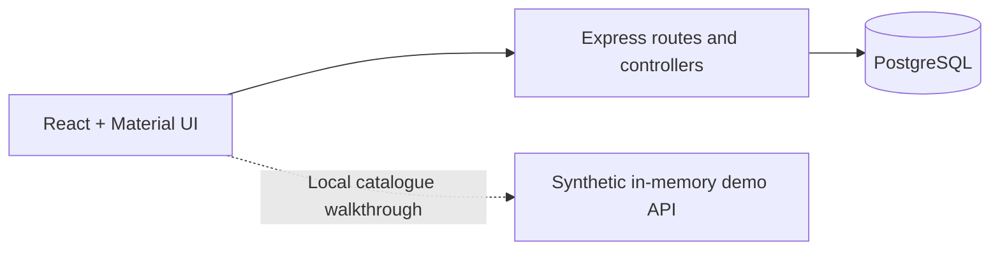

# Beyond the Seas

**Explore graduate-study options in one place.** Beyond the Seas is a coursework web application that connects academic profiles, university discovery and application planning through a React interface and an Express/PostgreSQL backend.

`React 18` · `Material UI` · `Node.js / Express` · `PostgreSQL`

[Run the demo](#1-synthetic-ui-demo-no-database-or-credentials) · [Architecture](#architecture) · [Verification](docs/VERIFICATION.md)

## Project highlights

- **University exploration:** tabular browsing, sorting, pagination and scholarship filtering.
- **Planning workflows:** source modules for shortlists, academic profiles and activities.
- **Recommendation logic:** SQL-based matching against academic and funding criteria, not a claimed machine-learning model or verified admission predictor.
- **Community features:** forum UI and API modules in the original application.
- **Reproducible portfolio path:** an isolated, explicitly synthetic catalogue demo that requires no credentials or external database.

The catalogue fixture is tested; original database-backed workflows remain unverified until the missing schema is restored. This distinction is intentional: a reviewer can explore the interface without mistaking sample outputs for validated recommendations.

## Architecture



The fixture adapter is separate from the original data-access layer. It never scrapes sites, imports personal records or connects to a live database.

## Two ways to explore

### 1. Synthetic UI demo (no database or credentials)

Requires Node.js 20+ and npm. From the repository root:

```sh
npm ci --prefix client
node Server/demo.js
```

In another terminal:

```sh
REACT_APP_DEMO=true npm start --prefix client
```

Open **http://localhost:3000/api/user/nonPersonalized/1**. The demo returns three explicitly fictional universities to the original React catalogue. Try sorting, pagination, scholarship filtering and adding a shortlist item. Data lives in memory and resets when the API restarts.

**Scope:** this is a fixture-backed walkthrough, not evidence of functioning recommendations or a complete database integration. Login, registration, academic analysis, forum and calendar are not supported by the fixture API. Unsupported requests return 501 rather than pretending to succeed. Never enter personal data. The fixture API binds only to loopback.

### 2. Original application (requires missing database setup)

```sh
npm ci --prefix Server
cp Server/.env.example Server/.env
# Set PostgreSQL connection values locally.
cd Server
npm start
```

Start the client in a separate terminal. PostgreSQL configuration uses standard `PGHOST`, `PGPORT`, `PGDATABASE`, `PGUSER`, `PGPASSWORD`, or `DATABASE_URL`. Client API base URL can be overridden with `REACT_APP_API_URL` before starting/building the client.

**Blocker:** the repository contains exploratory SQL, not a complete reproducible schema and migration set. The original API requires an owner-provided schema or a separately reviewed reconstruction. Do not run `practice_sql.sql` blindly against an existing database. This path is not currently verified end-to-end.

## Validation

```sh
node --test Server/test/*.test.js
npm run build --prefix client
```

The Node tests cover catalogue retrieval, shortlist state, invalid input and unsupported feature responses. They do not prove the PostgreSQL application works. See [verification notes](docs/VERIFICATION.md) for observed results.

## Layout

- `client/src/`: original React pages and components.
- `Server/routes/`, `controller/`, `db/`: API routing, handlers and PostgreSQL queries.
- `Server/demo.js`: isolated synthetic demo adapter.
- `Server/scrapper/`, `googleAPI/`: legacy integrations; not used by the demo.
- `apiDocumentation.md`: original API design notes.

## Safety and limitations

This is a coursework portfolio, not production-ready software. Original authentication and authorization require review before deployment. Dependencies include older Create React App packages and licensed MUI Pro components; review licenses and security findings before distributing or deploying. No credentials are needed by the fixture demo. Historic credentials were replaced in current runtime config, but Git history is preserved.

Original code, package names and contributor history are retained. Portfolio-readiness edits were prepared in November 2026; Git commit timestamps may retain the repository's previous tip timestamp at the owner's request and should not be interpreted as the date of these edits.

## Optional isolated demo container

```sh
docker build -f Dockerfile.demo -t beyond-the-seas-demo .
docker run --rm -p 127.0.0.1:3000:3000 -p 127.0.0.1:3002:3002 beyond-the-seas-demo
```

Ports are published only to host loopback. Docker execution has not been verified in the preparation environment.

